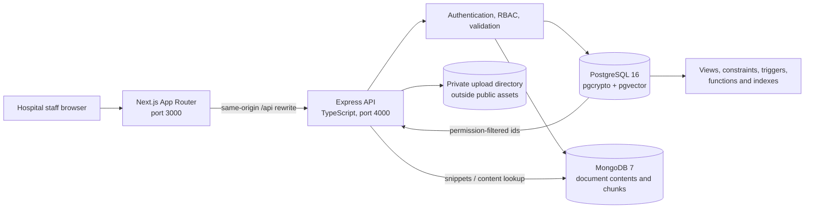

# DocuGuard Architecture

## System context

DocuGuard is a local-first policy and compliance application. The browser talks to the Next.js App Router frontend. The frontend proxies `/api/*` requests to the Express API; the browser and Next.js do not connect to either database directly.

The PostgreSQL schema is the source of truth for users, roles, permissions, document metadata and versions, access grants, notifications, acknowledgments, regulations, controls, search metadata, and the tamper-evident audit chain. MongoDB stores extracted document content and text chunks. PostgreSQL stores vector and full-text indexes in `document_chunks`.

## Request paths

### Authentication and authorization

1. A user submits credentials from the login page.
2. Express validates the request, verifies the bcrypt hash, and returns a signed JWT in an HTTP-only cookie.
3. Protected API middleware verifies the cookie and reloads the user's active status, role, and permissions from PostgreSQL on every request.
4. Route middleware checks the needed permission or role. SQL queries use the authenticated user id for ownership and access filters.

### Upload and approval

1. The browser uploads one allow-listed PDF or DOCX to Express.
2. Express stores it under `UPLOAD_DIR` with a random name, computes its checksum, and calls the ingestion interface.
3. PostgreSQL writes document and version rows in a transaction. Approval runs as a separate Admin action; a database CHECK and trigger enforce maker-checker and current-version transitions.
4. Access events are inserted in that transaction. A PostgreSQL trigger serializes inserts and builds the SHA-256 audit chain.

The ingestion service extracts text from PDF and DOCX files, stores document content and overlapping chunks in MongoDB, links generated ids to PostgreSQL versions, and compensates failed SQL writes by deleting Mongo content. A delayed orphan sweep handles failed compensation. After the SQL transaction commits, a local 384-dimensional embedding model indexes chunks in PostgreSQL; the document UI reports when indexing is pending. Scanned-image OCR is out of scope. Demo Markdown policies are loaded separately by the Mongo seed command.

### Search

`/api/search` supports keyword, semantic, and hybrid search. PostgreSQL first selects active, approved, unexpired document candidates through `fn_accessible_document_ids(user_id)`, then ranks their full-text or vector-indexed chunks (hybrid mode uses reciprocal-rank fusion). MongoDB supplies the returned snippet text. Similar-document results are also restricted to documents the caller can access.

### Dashboard, notifications, and dependency impact

- Dashboard summaries read PostgreSQL views. Expiring documents are filtered through `fn_accessible_document_ids`; non-Admin activity is scoped to the current user's audit rows.
- The API invokes the expiry functions at startup and every 24 hours. A transaction-scoped advisory lock serializes sweeps across API instances.
- Notification endpoints always include the authenticated user id in SQL predicates.
- Admin dependency graph and impact endpoints use recursive CTEs with path arrays to stop cycles.

### Break-glass access

One Express transaction inserts the temporary access override, flagged access-log row, and notifications for active Admins. The audit insert trigger hashes the flagged event in sequence. Admin review updates the override with reviewer and outcome; `fn_accessible_document_ids` grants only active overrides that have not expired.

## Technology and process boundaries

| Component | Responsibility |
|---|---|
| `frontend/` | Accessible Next.js pages and forms; calls only the Express API through `/api` rewrites. |
| `backend/src/routes/` | HTTP endpoints, Zod validation, authentication/permission middleware, and SQL orchestration. |
| `backend/src/services/` | Audit helper, expiry scheduler, and the current ingestion interface. |
| `database/postgres/` | Hand-written DDL, seed data, views, indexes, functions, triggers, and SQL tests. |
| `database/mongo/` | MongoDB indexes and current demo content seeder. |
| `docker-compose.yml` | Local PostgreSQL 16 with pgvector and MongoDB 7 services. |

Configuration is read from the repository-root `.env`, which is ignored by Git. `.env.example` documents required names with local placeholders. Migrations connect as the Compose administrator; Express connects as the restricted `docuguard_runtime` role.

## Key files

- Frontend API proxy: `frontend/next.config.ts`
- Express route registration: `backend/src/app.ts`
- Authentication and role loading: `backend/src/middleware/auth.ts`
- PostgreSQL schema and functions: `database/postgres/01a_schema_core.sql` through `09_documents.sql`
- MongoDB setup and demo content: `database/mongo/`
- Local service definitions: `docker-compose.yml`

The supplied ER diagram, data dictionary, and implementation blueprint are preserved under [`docs/inputs/`](inputs/).
